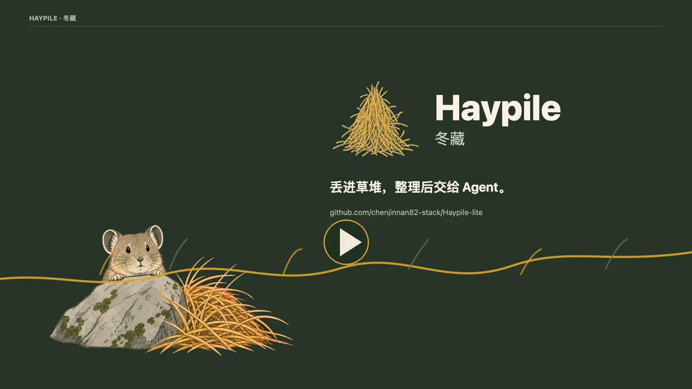
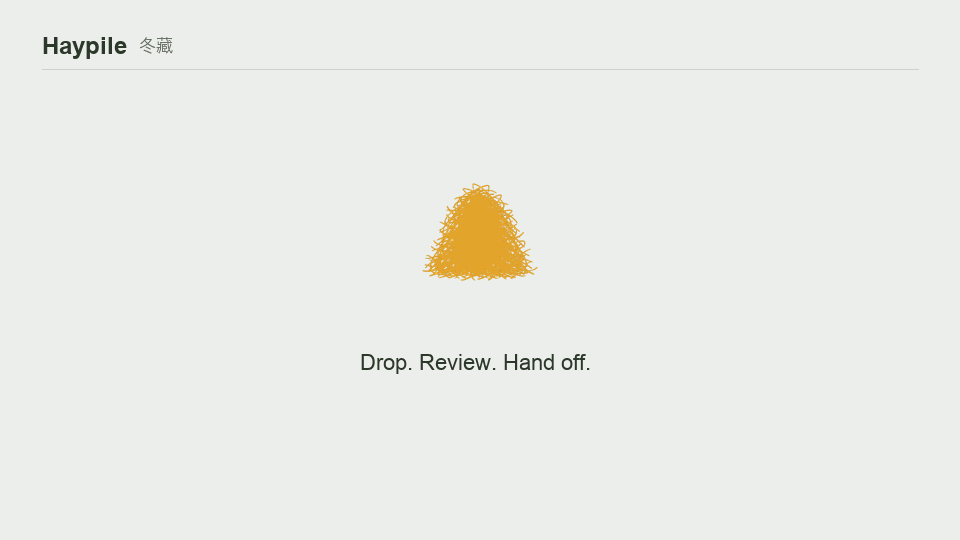

<div align="center">


# Haypile

**Drop it in the pile. Organize it, then hand it to your agent.**

A local-first asset intake for AI creators and independent developers.

[简体中文](README.zh-CN.md)


[](https://github.com/chenjinnan82-stack/Haypile-lite/actions/workflows/ci.yml)

</div>

## Font intake in the Alpha.10 development candidate

The current source accepts TTF / OTF / WOFF / WOFF2 files up to 50 MiB. Drag a browser address, page link, or direct font link onto the pile. Webpages are scanned for fonts in download links and static stylesheets. One small card previews one candidate at a time; **Store this font** saves its original bytes. Variable fonts use their default instance. The full asset manager provides font filtering, family search, custom sample text and size, and explicit missing-glyph feedback.

Confirm heading, body, or decorative usage before a font enters ready handoff. Read embedded license information, save source/license notes, and export the original bytes. Missing license information remains unknown; manual notes neither replace embedded metadata nor establish commercial rights. HTTP / MCP expose `type=font` and `font_usage`; see the [Agent HTTP contract](docs/AGENT_HTTP_CONTRACT.md).

Font details show mapped-character, CJK, basic Latin-letter, and digit counts. Filter by family to compare weights and formats while keeping the same sample text and size. Web candidates distinguish declared sources from actual rendered use; subset hints and [live-site checks](docs/WEB_FONT_VALIDATION.md) do not establish an accuracy rate. Image details offer up to five approximate main colors to copy. Audio details offer manual playback, pause/resume, and stop; hiding or changing assets stops playback. These controls stay in the existing card and manager.

The current source also discovers webpage covers, images, and site icons in supported formats. Switch fonts and images within the same card, preview one candidate at a time, and choose **Store this image** to save only its original file. See [desktop intake](docs/DESKTOP_INTAKE.md) for limits and static-page scope.

Click the pile to open its C-shaped shortcut ring, then choose Recent assets, including repeated intakes. Open an item to **Copy original file** or drag its preview into an app that accepts the file; font cards also offer **Export**. GIF, SVG, audio, and font files retain their original bytes. Taking a file does not confirm its usage or change its handoff status.

Optional asset groups live in the existing **All assets** management page. Create a named group, select an asset and use **Add to group…** to check or uncheck membership, then choose the group to **Copy ready group assets**. Groups span intake batches, keep references without duplicating files, and persist locally. The copied handoff contains only ready members and reports how many were omitted; collecting an asset still takes the same steps. See [desktop intake](docs/DESKTOP_INTAKE.md) and [Agent recipes](docs/AGENT_RECIPES.md).

Settings offers **Back up library / Restore backup** for portable manual backups and restoration into an empty library, preserving originals, usage, notes, collections, and recent order. See [backup and restore](docs/LIBRARY_BACKUP.md) for scope and limits.

This is a source acceptance candidate. The historical Alpha.8 downloads below do not include fonts, webpage extraction, or library backup/restore. TTC / OTC, fonts with embedded SVG glyphs, script-created styles, system installation, and variable-axis controls are outside this version. Selected text needs a page URL; system-only fonts cannot be downloaded from a page. See [font intake and its limits](docs/FONT_INTAKE.md).

## Desktop Downloads

The currently published download is `v0.3.0-alpha.8`, a prerelease for informed testing. The Alpha.10 features above are still undergoing source acceptance and are not in these packages.

| Platform | Download | Verify |
| --- | --- | --- |
| macOS Apple Silicon | [Haypile.app.zip](https://github.com/chenjinnan82-stack/Haypile-lite/releases/download/v0.3.0-alpha.8/Haypile-v0.3.0-alpha.8-macos-arm64.app.zip) | [SHA-256](https://github.com/chenjinnan82-stack/Haypile-lite/releases/download/v0.3.0-alpha.8/Haypile-v0.3.0-alpha.8-macos-arm64.app.zip.sha256) |
| Windows x64 | [Portable ZIP](https://github.com/chenjinnan82-stack/Haypile-lite/releases/download/v0.3.0-alpha.8/Haypile-v0.3.0-alpha.8-windows-x64.zip) | [SHA-256](https://github.com/chenjinnan82-stack/Haypile-lite/releases/download/v0.3.0-alpha.8/Haypile-v0.3.0-alpha.8-windows-x64.zip.sha256) |

[Release notes](https://github.com/chenjinnan82-stack/Haypile-lite/releases/tag/v0.3.0-alpha.8)

The macOS build is ad-hoc signed and not notarized; right-click the app and
choose **Open** on first launch. The Windows build is unsigned and portable;
unzip it before running `Haypile.exe`. Haypile keeps controlled local copies,
but an Alpha build must not be the only backup of material you cannot replace.

## Brand Concept Film (60 seconds)

[](https://github.com/chenjinnan82-stack/Haypile-lite/releases/download/v0.3.0-alpha.6/Haypile-v0.3.0-alpha.6-product-overview-zh.mp4)

This Alpha.6-era film remains as a brand concept and no longer represents the
current product interface. The GIF below is likewise the original workflow
illustration; current intake and attached-hub layouts are generated by the
repository's offscreen visual smoke commands.

## See It Work



The pile stays on the desktop. Click for the C-shaped ring, then choose **Recent assets**, **All assets**, **Agent**, or **Settings**; the context menu also retains management and **Quit**. Drag a file or webpage link onto it for intake. The card is 280 points wide, with font details expanded inline. An outside click closes the card and still reaches the original page. Full management opens through its explicit entry. See [desktop intake design](docs/DESKTOP_INTAKE.md).
The illustration uses repository-owned sample assets and does not read user material.

## Three Steps

1. **Drop** images from Finder, Explorer, or a browser. Audio remains supported.
2. **Review** the latest batch. Haypile hashes, deduplicates, registers, and can
   suggest image roles with a local model or an authorized API.
3. **Hand off** the latest ready batch to Codex or another agent through HTTP,
   MCP, or `asset-handoff.v1` JSON.

```text
Browser / desktop -> Haypile -> latest ready batch -> HTTP / MCP -> Agent
```

## Safety Boundary

Haypile is local-first by design:

- The service binds to `127.0.0.1` and static files are manifest-gated.
- Agents receive registered URLs and provenance, not filesystem access.
- HTTP and MCP are read-only; agent writes and deletes are not exposed.
- Remote AI requires explicit domain authorization and HTTPS outside localhost.
- API keys use macOS Keychain or Windows Credential Manager and never enter
  `gui_state.json`, logs, provenance, or handoff data.
- Cloud vision requests omit original filenames and local absolute paths.

See [Security Policy](SECURITY.md) or [report privately on GitHub](https://github.com/chenjinnan82-stack/Haypile-lite/security/advisories/new).

## Current Alpha Capabilities

- True GIF intake from local files, direct `image/gif` URLs, and file
  attachments, with original bytes preserved and strict frame-by-frame limits.
- One-loop GIF preview, manual reaction/sticker/UI-animation roles, and no GIF
  AI sorting. New GIFs stay pending until a role is confirmed.
- Explicit clipboard intake for files, exact GIF payloads, and safe direct
  media URLs. Pixel-only clipboard images are stored as static PNGs.
- Verified GIF MIME, frame count, declared duration, and loop count travel
  through the manifest, HTTP, MCP, and `asset-handoff.v1`.
- A Qt-free shared intake transaction and cross-process writer lock keep GUI
  intake and startup recovery from modifying the same open batch.
- Image, audio, and GIF entry motion now uses one reproducible renderer that can
  be verified offscreen without starting storage or the backend.
- The floating UI appears before storage hydration and backend startup. If
  storage is unavailable, intake stays disabled while Settings and Quit remain
  usable; shutdown only stops a backend owned by this GUI.
- The Assets drawer, pending badge, and service status share the same explicit
  storage configuration and manifest fail-close catalog. Experimental
  real-project workflows stay outside normal drawer startup.
- Daily intake uses the pile, a C-shaped shortcut ring, and one nonmodal card. The ring and card are mutually exclusive; font candidates no longer open a large picker, and full management opens only when explicitly selected.
- Cards and management retain native keyboard focus, checked state, and accessible descriptions; there is no transparent connector area intercepting page input.
- Settings lookup no longer prepares product storage or creates IPC secrets;
  release CI and both package builds use the same exact Python and dependency
  constraints.
- A privacy-safe clipboard diagnostic reports only format names, sizes, and the
  selected route; app-private animated emoji remain unsupported.
- The empty Assets drawer points to drag and clipboard intake, while Settings
  can copy a privacy-safe runtime diagnostic without asset names, paths, URLs,
  hashes, or keys.
- Intake finishes before AI sorting, so an offline or slow model never blocks storage.
- Every drop has a stable batch ID; duplicates still belong to the new batch.
- Image roles include background, hero, logo, icon, content image, and texture.
- Local technical quality gates decide readiness; the model does not judge aesthetics.
- The Agent drawer can copy the latest batch instead of the whole asset library.
- AI defaults to **Off**; local/API modes are optional, with no automatic model
  installation or download. Existing explicit choices are retained. Intake,
  preview, keyword search, manual organization, original-file reuse, and library
  backup/restore work without AI.
- External Agents use read-only HTTP/MCP tools and their own capabilities. Tools
  return metadata and controlled URLs; description-based image selection requires
  vision and actual image access and is not promised for arbitrary models.

## Agent Access

The local backend defaults to `http://127.0.0.1:8010`.

```text
GET /healthz
GET /readyz
GET /api/v1/batches/latest
GET /api/v1/bundles?status=ready&batch_id=latest
GET /api/v1/bundles/{bundle_id}
```

Source-mode MCP configuration:

```json
{
  "mcpServers": {
    "haypile": {
      "command": "python3",
      "args": ["/absolute/path/to/Haypile-lite/mcp_server.py"],
      "env": {"HAYPILE_BASE_URL": "http://127.0.0.1:8010"}
    }
  }
}
```

Packaged apps use the Haypile executable with `--mcp`:

```json
{
  "mcpServers": {
    "haypile": {
      "command": "/Applications/Haypile.app/Contents/MacOS/Haypile",
      "args": ["--mcp"]
    }
  }
}
```

On Windows, set `command` to the absolute path of `Haypile.exe` and keep the
same `--mcp` argument. The Agent drawer can copy the correct configuration.

Read the [HTTP contract](docs/AGENT_HTTP_CONTRACT.md) and
[Agent recipes](docs/AGENT_RECIPES.md) for the complete handoff shape.

## Run From Source

```bash
git clone https://github.com/chenjinnan82-stack/Haypile-lite.git
cd Haypile-lite
python3 -m pip install -r requirements-desktop.txt
python3 app_gui.py
```

Headless smoke demo:

```bash
python3 -m pip install -r requirements-core.txt
python3 examples/public_smoke_demo.py --out /tmp/haypile-demo
```

Tests:

```bash
python3 -m unittest discover -s tests
```

Build notes live in [macOS internal build](docs/MACOS_INTERNAL_BUILD.md) and the
platform scripts under `scripts/`. The
[alpha.9 release notes](docs/OPEN_SOURCE_RELEASE.md) record the exact feature
and support boundary; the private release gate is documented in
[AI evaluation](docs/AI_EVALUATION.md).

## Project Notes

- This repository and its tagged releases are the only public Haypile source.
- Haypile is not a cloud DAM, multi-user sync service, or agent-write platform.
- Equal SHA-256 content is one logical asset. Haypile does not yet provide
  per-project identities, multiple simultaneous roles, or workspace isolation.
- Haypile keeps controlled copies, but it is not the only backup for valuable source material.
- Experimental real-project apply/rollback helpers remain disabled and outside
  the public agent surface.

Questions and reproducible product feedback belong in
[GitHub Issues](https://github.com/chenjinnan82-stack/Haypile-lite/issues).
Small, focused contributions are welcome; see [CONTRIBUTING.md](CONTRIBUTING.md).

MIT licensed. See [LICENSE](LICENSE) and [NOTICE](NOTICE).
